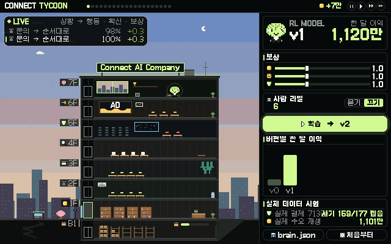
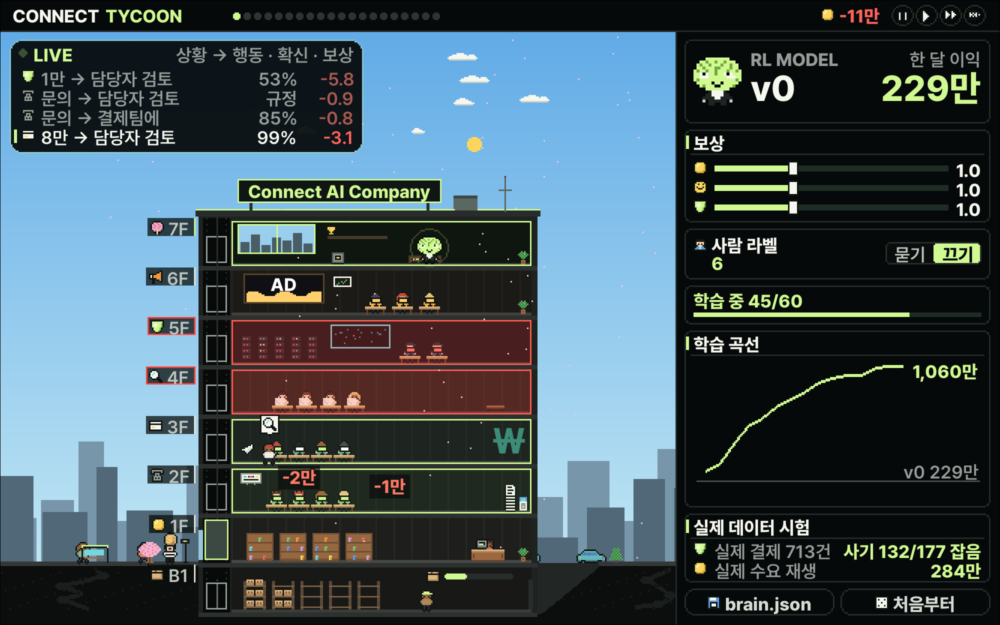
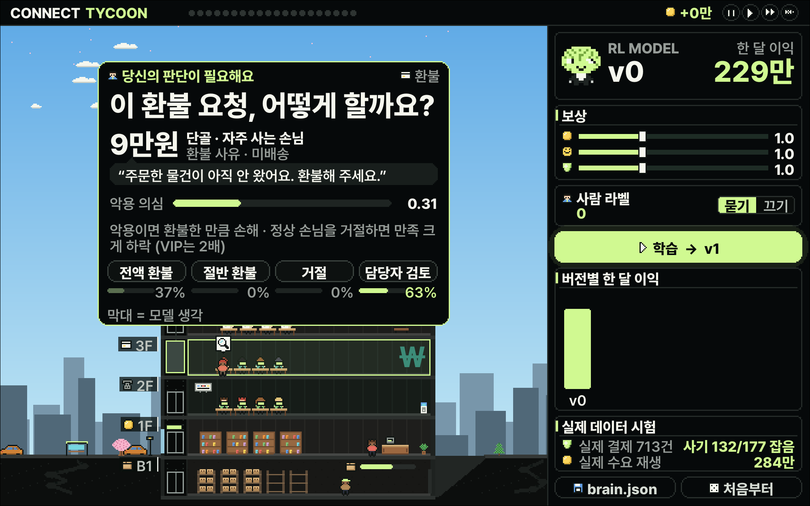
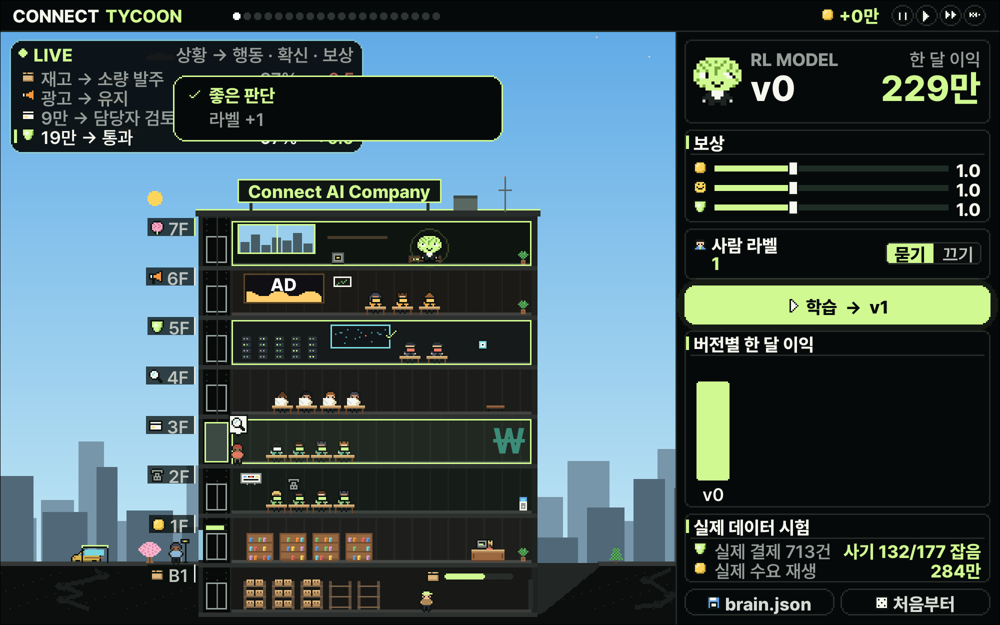
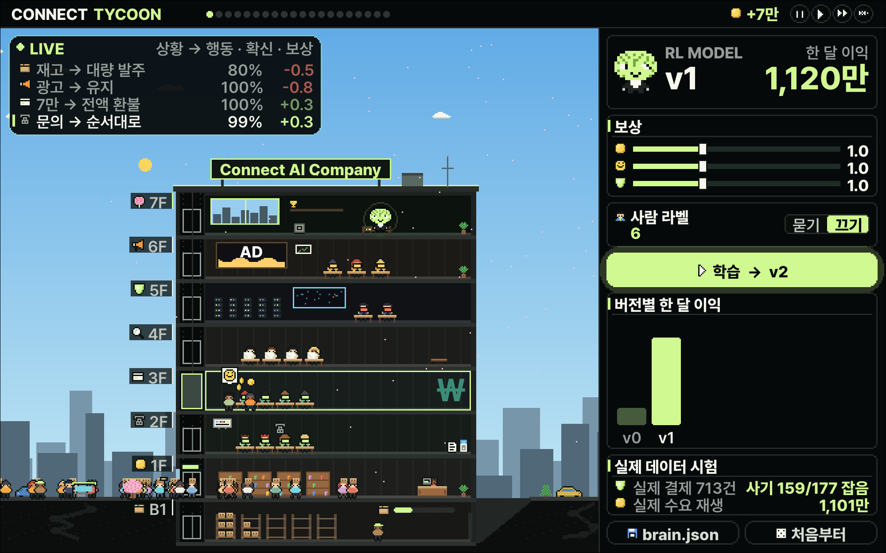

# CONNECT TYCOON

**시뮬레이터로 기업 의사결정 모델을 학습시킵니다.**



모델은 빌딩 맨 위층에서 회사를 운영합니다. 판단 하나가 빛줄기가 되어 층으로 내려가고, 그 결과가 돈 · 고객 만족 · 사고로 돌아옵니다.
학습 버튼을 누르면 모델이 시뮬레이터에서 수백 번 회사를 운영하며 스스로 배우고, 확신이 없을 때는 사람에게 묻습니다.

AI 교육 브랜드 **[CONNECT AI LAB](https://www.youtube.com/@CONNECT-AI-LAB) × [AI CITY BUILDERS](https://www.aicitybuilders.com)**의 강화학습 수업에서 만든 오픈소스 · Apache-2.0

---

## 학습은 이렇게 됩니다

| | |
|---|---|
|  | **① 강화학습 · 시뮬레이터에서 스스로**<br>모델이 한 달을 수백 번 운영합니다. 보상이 커진 판단을 더 자주 하도록 고칩니다 (PPO). |
|  | **② 사람 확인 · 확신이 낮을 때만**<br>모델이 확신하지 못한 판단은 게임을 멈추고 사람에게 묻습니다. 사람이 고른 답은 라벨이 되어 지도학습으로 들어갑니다. |
|  | **③ 바로 채점**<br>시뮬레이터가 선택지마다 한 달을 끝까지 다시 돌려, 내 답이 좋았는지 바로 알려 줍니다. |
|  | **④ 버전**<br>학습할 때마다 v1, v2… 새 모델이 회사를 맡고, 버전별 한 달 이익이 쌓입니다. |

## 시작

```bash
git clone https://github.com/wonseokjung/connect-tycoon
cd connect-tycoon
pip install -e ".[game]"
connect-tycoon play
```

| 조작 | |
|---|---|
| 학습 → v1 | 지금 모델에서 이어서 학습 (강화학습 + 사람 라벨) |
| 보상 막대 | 이익 · 고객 만족 · 위험 회피, 무엇이 중요한지 |
| 사람 라벨 · 묻기/끄기 | 확신이 낮은 판단을 사람에게 물을지 |
| brain.json | 학습한 모델을 내려받기 (`~/Downloads`) |
| 스페이스 · Esc | 일시정지 · 타이틀 |

## 보상은 결과에 줍니다

```
보상 = 이익 × 번 돈 + 고객 만족 × 만족 변화 − 위험 회피 × 사고
```

행동에 점수를 매기지 않습니다. 시뮬레이터가 행동의 결과를 계산하고, 사람은 무엇이 중요한지(세 가중치)만 정합니다.
그 사이의 판단 규칙은 강화학습이 찾습니다.

## 공개 데이터로 맞춘 회사 · 실제 데이터로 시험

시뮬레이터의 숫자는 지어낸 값이 아니라 여러 업종의 공개 데이터에서 가져옵니다.
업종과 상관없이 나타나는 **모양**(요일 패턴 · 하루 수요 흔들림 · 취소 금액 분포 · 사기 비율과 점수 · 서비스 실패 뒤 만족 하락)만 쓰고,
크기(손님 수 · 가격)는 회사마다 다르므로 기본 규모에 맞춥니다.

| 데이터 | 업종 | 쓰는 곳 |
|---|---|---|
| UCI Online Retail II | 소매 | 요일 수요 · 하루 흔들림 · 취소 요일 · 환불 금액 · 고객 등급 |
| Hotel Booking Demand | 숙박 | 요일 수요 · 하루 흔들림 · 취소 요일 · 고객 등급 |
| UCI Bike Sharing | 대여 서비스 | 요일 수요 · 하루 흔들림 |
| ULB Credit Card Fraud | 금융 | 사기 비율 · 사기 점수 · 결제 금액 |
| Olist | 배송 마켓 | 서비스 실패 뒤 만족 하락 |
| Bitext Customer Support | 고객센터 | 문의 유형 → 팀 |

그리고 학습이 끝날 때마다 **학습에 쓰지 않은 실제 기록**으로 다시 채점합니다.

| 처음 보는 실제 카드 거래 713건 (사기 177건) | 손실 줄임 | 잡은 사기 | 실제 수요 재생 · 한 달 이익 |
|---|---|---|---|
| 규칙 | 68% | 138 | 305만 |
| 강의 회사에서 배운 모델 그대로 | 74% | 145 | 1,059만 |
| 일반 회사에서 이어서 학습 | **90%** | **161** | **1,243만** |

```bash
connect-tycoon backtest --brain my-model.json        # 실제 데이터 시험
connect-tycoon train --profile general               # 일반 회사(기본) · lecture는 강의 엔진
python scripts/calibrate.py --data ~/connect-data    # 공개 데이터로 프로필 다시 만들기 (pip install -e ".[data]")
```

순서는 **일반 회사 → 우리 회사**입니다. 한 회사의 실제 기록(주문 · 환불 · 문의 · 결제)을 같은 방법으로 넣으면 그 회사의 프로필이 되고,
일반 모델에서 이어서 학습해 그 회사 전용 의사결정 모델이 됩니다. 실제 데이터에 없는 값(악용 비율 · 기기 신호 · 비용)은 가정이며 프로필의 `assumed`에 적혀 있습니다.

## 모델이 답하는 모양 · JEV

회사의 판단 하나는 JEV 요청 하나입니다. 상황(`state`)과 선택지(`criteria`)를 받아 `choice` · `probabilities` · `confidence`로 답합니다.
OpenRouter의 `typesafe/jev-1.13`과 같은 모양이라, JEV를 말하는 모델이면 무엇이든 이 시뮬레이터에서 학습하고 시험할 수 있습니다. → [docs/JEV.md](docs/JEV.md)

## 언어 모델(Qwen)로 옮기기 · RL AI COMPANY DECISION MAKING MODEL

시뮬레이터에서 강화학습한 작은 정책을 선생님으로, **Qwen3.5-0.8B**가 글로 된 문제를 읽고 판단하도록 학습합니다.
**강화학습 → 지도학습 → 다시 강화학습** 순서입니다.

| 단계 | 하는 일 |
|---|---|
| ① 문제집 | 판단마다 선택지를 하나씩 바꿔 그 달을 끝까지 다시 돌려, 선택지별 점수를 매깁니다 |
| ② 지도학습 | 점수가 가장 높은 보기 글자를 따라 배웁니다 (LoRA) |
| ③ 강화학습 | 보기 전체를 한 묶음으로 보고, 점수가 평균보다 높은 보기의 확률을 올립니다 (묶음 표준화 + KL) |
| ④ 채점 | 시험 문제 정답률 · Qwen을 회사 사장 자리에 앉혀 한 달 운영 · 실제 데이터 시험 |
| ⑤ 공개 | Hugging Face에 어댑터 + 모델 카드 (`HF_TOKEN`) |

문제 하나는 C1과 같은 모양입니다: 상황 · 질문 · 보기(A, B, C…)를 받고 글자 하나로 답하며, 보기 글자의 확률이 선택지별 확률입니다.

**Mac (Apple Silicon · MLX)**

```bash
pip install -e ".[llm-mac]"
connect-tycoon train --profile general --name teacher --out teacher.json
connect-tycoon llm data --teacher teacher.json --out llm_data --train-months 10
connect-tycoon llm sft  --data llm_data --out adapters/sft
connect-tycoon llm rl   --data llm_data --from adapters/sft --out adapters/rl
connect-tycoon llm eval --data llm_data --adapter adapters/sft --adapter adapters/rl --months 2 --save eval.json
connect-tycoon llm push --adapter adapters/rl --data llm_data --results eval.json
```

**Windows · Linux (NVIDIA GPU · PyTorch)** · 위 명령에 `--backend torch`를 붙입니다 (`pip install -e ".[llm]"`). Mac은 자동으로 MLX를 씁니다.

**Colab (GPU · PyTorch)** · 시뮬레이터 → Qwen 지도학습 → 강화학습 → 내 Hugging Face 계정에 업로드까지 한 번에

[](https://colab.research.google.com/github/wonseokjung/connect-tycoon/blob/main/notebooks/rl_decision_model_qwen_colab.ipynb)

첫 결과 · [WonseokJayJung/rl-ai-company-decision-model-0.8b](https://huggingface.co/WonseokJayJung/rl-ai-company-decision-model-0.8b) · 학습 전 한 달 −1,340만 → 지도학습 +635만 → 강화학습 +757만 · 실제 사기 거래 손실 37% → 71% 줄임

강화학습한 작은 정책의 판단을 JEV 형식 데이터로 내보낼 수도 있습니다: `connect-tycoon jev --brain my-model.json --months 10 --out jev.jsonl`

## 개발자용

```python
import gymnasium as gym, connect_tycoon
env = gym.make("ConnectTycoon-v0")            # 한 달 = 에피소드, 판단 하나 = 스텝, action_mask 포함
```

```bash
connect-tycoon train --name my-model --profit 2      # 터미널에서 학습
connect-tycoon push --brain my-model.json            # Hugging Face (HF_TOKEN)
connect-tycoon record --brain my-model.json --mp4    # 모델이 운영하는 하루를 영상으로
```

Colab: [`notebooks/connect_tycoon_colab.ipynb`](notebooks/connect_tycoon_colab.ipynb) · 설계: [docs/DESIGN.md](docs/DESIGN.md)

## 다음

- 우리 회사 데이터 넣기 · CSV를 넣으면 프로필과 실제 데이터 시험이 그 회사 기준으로
- 질문 만들기 · 사람이 질문 · 행동 · 결과표를 직접 정해 자기 회사의 의사결정을 추가
- 산업별 시뮬레이터 · 쇼핑몰 다음으로 병원 · 물류 · 금융 같은 업종마다 하나씩
- 각자 키운 모델을 Hugging Face에 올리고 한곳에 모으기 (Connect AI)

## 만든 곳 · CONNECT AI LAB × AI CITY BUILDERS

**Transforming Lives Through AI Education.** AI를 쓰는 사람에서, AI로 직접 만들고 일하는 사람으로.
AI 멘토 제이(정원석)가 만드는 과정을 그대로 공개하고, 그 과정을 기초부터 따라 할 수 있는 교육으로 만듭니다.

| | |
|---|---|
| **[CONNECT AI LAB · 유튜브](https://www.youtube.com/@CONNECT-AI-LAB)** | 구독자 12만+ · 영상 300편+ 무료 강의. AI 1인 기업, 로컬 AI, 강화학습, 피지컬 AI, JEV까지 직접 해 보며 배웁니다. |
| **[AI CITY BUILDERS](https://www.aicitybuilders.com)** | AI BUSINESS UNIVERSITY · **AI 비즈니스의 정석.** AI 1인 기업부터 기존 기업의 AI 전환까지, 이북 → 영상 실습 → 비즈니스 적용 순서로 배웁니다. |
| **[Connect AI](https://www.ezerai.xyz)** | 독립된 두뇌, 연결되는 지능. 기업 의사결정을 위한 우리 모델 [C1](https://huggingface.co/WonseokJayJung/Connect-C1-0.8B-v0.1)을 멤버들과 함께 연구합니다. |

**이 저장소와 이어지는 수업**

- [강화학습 AI 과정](https://www.aicitybuilders.com/robot): 로봇부터 JEV까지. 상태 · 행동 · 보상으로 문제를 바꾸고, DQN · PPO로 두뇌를 학습시키고, 마지막 강 「강화학습 × JEV」에서 1인 기업 자동화에 적용합니다.
- [무료 강화학습 실험실](https://www.aicitybuilders.com/explore): 탐험하지 않으면 9점, 탐험하면 178점. 브라우저에서 바로 눌러 보는 강의 속 실험.
- 유튜브 재생목록 [AI 강화학습을 알면 인생이 보입니다](https://www.youtube.com/playlist?list=PLSDuOiEMMABU) · JEV 영상 [이론부터 무료 실습까지](https://www.youtube.com/watch?v=p4Mn6KFsSeM) · [내 PC에서 JEV 같은 AI 돌리기](https://www.youtube.com/watch?v=u5EL3dNwJpw)
- 어디서 시작할지 모르겠다면: [무료 AI 학습 길찾기](https://www.aicitybuilders.com/ask)

여기서 학습시킨 의사결정 모델을 각자 Hugging Face에 올리고, 한곳에 연결해 함께 논문으로 씁니다 (CONNECT AI LAB 대표 멤버십 공동 연구).

## 라이선스

코드 · 그림 · 소리는 [Apache-2.0](LICENSE). 글꼴은 [프리텐다드](https://github.com/orioncactus/pretendard)와 [갈무리](https://github.com/quiple/galmuri) (SIL OFL 1.1).
공개 데이터의 출처와 라이선스(CC BY 4.0 · DbCL · CDLA-Sharing · Olist는 CC BY-NC-SA로 요약 통계 세 개만 사용)는 [NOTICE](NOTICE)에 있습니다.

합성 시뮬레이터 위의 교육용 모형입니다. 실제 경영 성과를 보장하지 않습니다.
